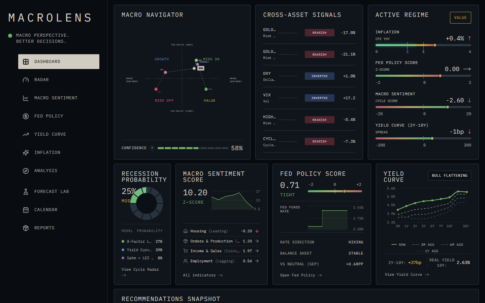
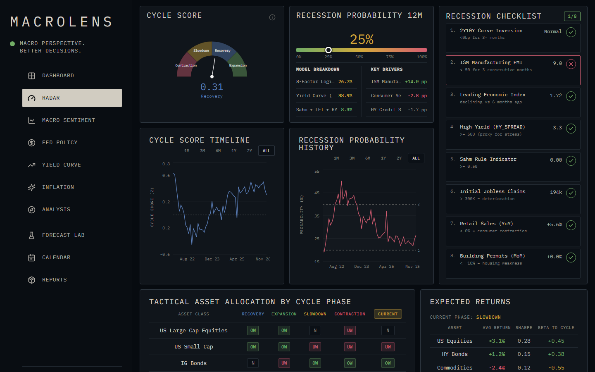
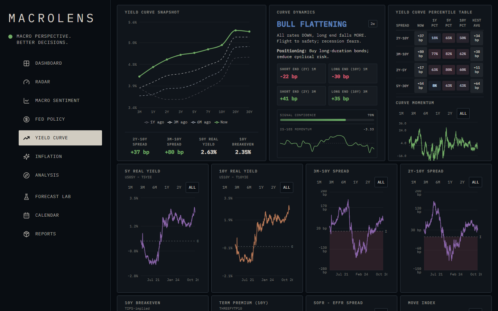
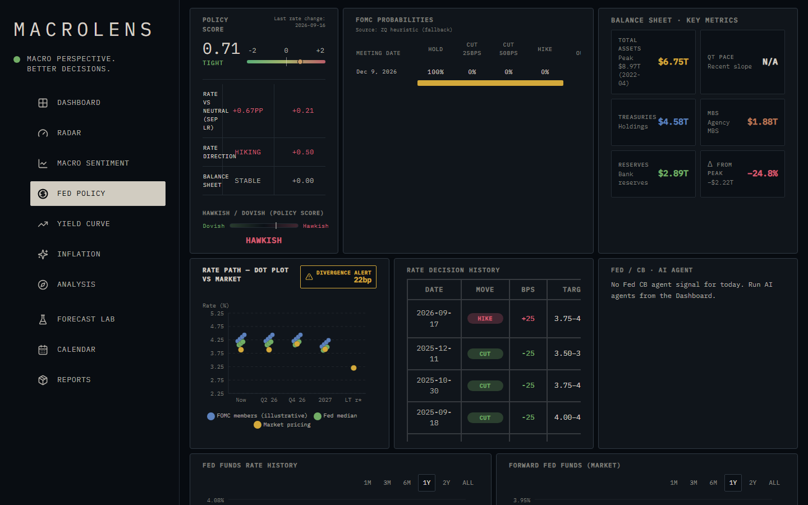
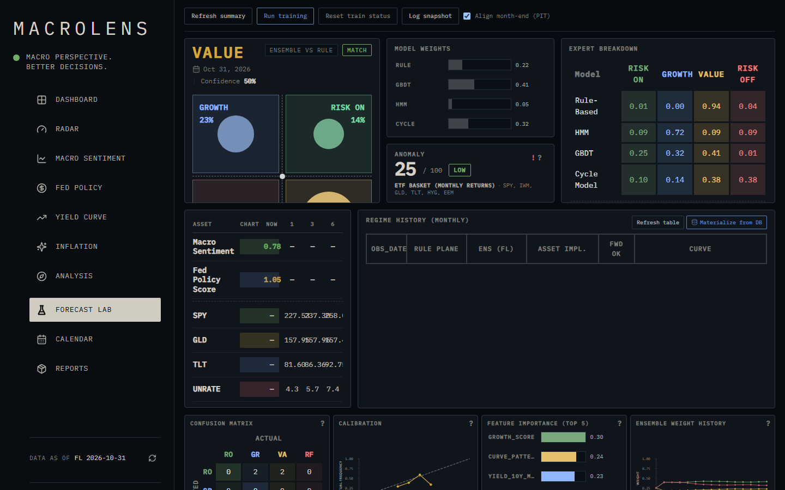

# MacroLens

**Macro trading terminal** for regime analysis, Fed policy, yield curves, inflation, cross-asset
confirmation, Forecast Lab diagnostics, and report-ready market intelligence.

<p align="center">
  <a href="https://macrolens-terminal.vercel.app/dashboard"><strong>Live app</strong></a>
  &nbsp;·&nbsp;
  <a href="DEPLOY.md">Deploy</a>
  &nbsp;·&nbsp;
  <a href="USER_GUIDE.md">User guide</a>
  &nbsp;·&nbsp;
  <a href="llms.txt">API reference (llms.txt)</a>
</p>

<p align="center">
  <a href="https://github.com/imnotkeril/macrolens/actions/workflows/ci.yml"></a>
  <a href="LICENSE"></a>
  
  <a href="https://fastapi.tiangolo.com/"></a>
  <a href="https://nextjs.org/"></a>
  
  
</p>

MacroLens combines economic indicators, Fed policy, yield curve dynamics, inflation, market breadth,
cross-asset signals, AI-assisted context, and Forecast Lab model artifacts into a signal-first
dashboard for macro trading decisions.

Production (as configured by the owner): web on Vercel, API on Hugging Face Spaces, Postgres on
Supabase. See [DEPLOY.md](DEPLOY.md) for the hosting setup.

---

## Contents

- [Screenshots](#screenshots)
- [Quick start](#quick-start)
- [Architecture](#architecture)
- [What MacroLens does](#what-macrolens-does)
- [Features](#features)
- [Stack](#stack)
- [Requirements](#requirements)
- [Structure](#structure)
- [Install and run with Docker](#install-and-run-with-docker)
- [Install and run locally](#install-and-run-locally)
- [Environment variables](#environment-variables)
- [Migrations](#migrations)
- [Security model](#security-model)
- [Data sources and scheduler](#data-sources-and-scheduler)
- [Tests and code quality](#tests-and-code-quality)
- [Deployment](#deployment)
- [Documentation](#documentation)
- [Operational notes](#operational-notes)
- [License](#license)

---

## Screenshots

Captured from the local stack on 2026-11-02 (real FRED and market data, 1440×900).

| | |
|---|---|
| **Dashboard and Navigator**<br> | **Cycle Radar**<br> |
| **Yield Curve**<br> | **Fed Policy**<br> |
| **Forecast Lab**<br> | |

---

## Quick start

The shortest path to a running terminal (Docker, Compose v2):

```powershell
Copy-Item .env.example .env                      # then set FRED_API_KEY (free key from fred.stlouisfed.org)
docker compose up --build                        # http://localhost:3000
```

Open <http://localhost:3000>. The first screens are empty until data is loaded: set
`ALLOW_UNAUTHENTICATED_ADMIN=true` in `.env` (local only) or `ADMIN_API_KEY`, then press the refresh
control in the UI (or `POST /api/data/refresh` with `X-API-Key`). Details: [Install and run with Docker](#install-and-run-with-docker),
[Install and run locally](#install-and-run-locally), [Environment variables](#environment-variables).

---

## Architecture

```text
Browser ──> Next.js 16 (frontend, :3000)
              │  rewrites /api/* (resolved at build time: BACKEND_URL / BACKEND_INTERNAL_URL)
              v
          FastAPI (backend, :8000) ── SecurityMiddleware (X-API-Key, rate limit, body limit)
              │        │
              │        └── APScheduler jobs: FRED / Yahoo / Fed / calendar ingestion, alerts, memory
              v
   PostgreSQL 16 (+ pgvector if present)      Redis 7 (cache)
              ^
   Forecast Lab artifacts (HMM + XGBoost bundle, backend/data/forecast_lab_artifacts)
```

The backend owns all data and models; the frontend is a thin read-mostly client. Reads are public;
state-changing, training and LLM endpoints require an admin key (see [Security model](#security-model)).

---

## What MacroLens does

| Layer | Purpose | Primary pages |
|------|---------|---------------|
| **Macro cycle** | Cycle Radar: 8-variable cycle score, recession probability, phase mapping | Dashboard, Radar, Macro Sentiment |
| **Fed policy** | Policy score from rate level vs neutral, rate direction and balance sheet direction | Dashboard, Fed Policy |
| **Yield curve** | Spreads, curve momentum, tenor snapshots, percentiles, curve-pattern labels | Dashboard, Yield Curve, Radar |
| **Inflation** | CPI, PCE, PPI, breakevens, expectations, component contribution | Inflation |
| **Market confirmation** | Relative performance, breadth, indices, Bitcoin, cross-asset signals | Analysis, Dashboard |
| **Forecast Lab** | Phase probabilities, macro forecasts, ensemble, stress diagnostics, feature importances | Forecast Lab |
| **Workflow outputs** | Briefings, event review, FOMC minutes, print-ready reports | Calendar, Reports |

The core decision view is the **Navigator**: a 2×2 regime matrix. Its growth axis is a weighted
indicator score and its policy axis is the Fed policy score. The four quadrants are
`Q1_GOLDILOCKS`, `Q2_REFLATION`, `Q3_OVERHEATING` and `Q4_STAGFLATION`. The KPI definitions are kept
outside the repository, in the project's local docs.

---

## Features

### Dashboard and Navigator

- Navigator quadrant, cycle score, Fed policy score, recession probability, yield curve snapshot
- Cross-asset confirmation (risk, dollar, commodities, volatility, curve signals)
- Allocation summary, factor tilts, sector and geography bias, trading ideas

### Radar (Cycle Radar)

- Cycle score (-100 to +100) from eight weighted variables, with driver attribution
- Recession probability as the mean of three models, with per-model results
- Recession checklist and phase-transition signals; Light FCI

### Macro Sentiment

- Leading, coincident, lagging and inflation indicator groups with category scores
- KPI history and indicator details, with loading, error and empty states

### Fed Policy

- Policy score and stance, FOMC probabilities, rate-decision history
- Rate path and dot-plot views, Fed balance sheet metrics
- AI context card when the agent services are configured

### Yield Curve

- Treasury tenor snapshot, 2Y10Y and related spread history
- Curve momentum, percentile tables, curve dynamics and pattern labels
- SOFR/EFFR context where available

### Inflation

- CPI, Core CPI, PCE, Core PCE, PPI, Core PPI; breakevens and expectations
- Single-line, dual-line and component-contribution charts

### Analysis

- **Relative Performance**: sector, currency and sentiment-relative charts
- **Major Indices & Bitcoin**: index trend context, Bitcoin and dominance overlays
- **Market Breadth**: participation, highs and lows, moving-average breadth
- **Macro Overview**: macro ratios and cross-check charts

### Forecast Lab

- Phase probability and ensemble dashboard (HMM and GBDT experts, plus a Cycle Radar expert when enabled)
- Macro forecasts by series and horizon, stress bands and top z-score contributors
- Feature importance, trained artifact metadata, historical regime alignment, diagnostics
- Training runs in a background worker with progress tracking and reset

### Intelligence (optional)

- Agents: Fed, news, macro-data and master agents produce signals and a recommendation.
  Without an Anthropic key they fall back to rule-based output.
- Memory: snapshots and domain records with retrieval (`/api/memory`). Embeddings are OpenAI when a key
  is set, otherwise a hash fallback.
- Alerts with read state; calendar canary feed for calendar data quality

### Calendar and Reports

- Briefings, economic calendar, events explorer, FOMC minutes, news views (some still use demo data)
- Report hub and print/preview layouts
- Compatibility redirects: `/next/*` to production routes, `/indicators` to Macro Sentiment, `/compare` to Dashboard

---

## Stack

| Layer | Technology |
|------|------------|
| Backend API | Python 3.12, FastAPI, Pydantic Settings, SQLAlchemy 2 (async, asyncpg), Alembic, APScheduler |
| Analytics and ML | pandas, NumPy, scikit-learn, XGBoost, hmmlearn |
| Data stores | PostgreSQL 16 (pgvector used when available), Redis 7 |
| Frontend | Next.js 16 (App Router, standalone output), React 18, TypeScript, Tailwind CSS 3, TanStack Query, Recharts, lightweight-charts |
| Containers | Docker Compose: `db`, `redis`, `backend`, `frontend` |

---

## Requirements

- **Docker** and Docker Compose v2 for the full stack
- **Python 3.12** (matches CI and the backend image)
- **Node.js 20.9+** for the frontend (Next.js 16); the frontend image uses Node 20
- **FRED API key** for real macro data
- **Network access** to FRED, Yahoo, CoinGecko and CME endpoints
- **RAM** 4 GB+ recommended; Forecast Lab training and large artifacts need more

---

## Structure

```text
.github/workflows/ci.yml          CI: backend (ruff, black, isort, mypy, pytest) and frontend (lint, typecheck, build)
backend/
  app/
    main.py                       FastAPI app, lifespan (schema bootstrap, scheduler), routers, /api/health
    config.py                     Settings (env and backend/.env)
    security.py                   X-API-Key guard, per-IP rate limit, request body limit
    database.py                   async engine and session
    api/                          15 routers: agents, alerts, calendar, calendar_canary, data, fed, forecast_lab,
                                  indicators, market, memory, ml, ml2, navigator, regime, yield_curve
    models/                       SQLAlchemy ORM models
    schemas/                      Pydantic schemas (API responses, agent outputs)
    services/                     analytics, data ingestion, Forecast Lab, agents, memory, LLM clients
      agents/                     Fed, macro-data, news and master agents
      data_sources/               provider adapters (FRED, Yahoo) and router
      forecast_lab/               phase, macro and recession models; ensemble; diagnostics
      llm/                        Claude client, JSON extraction, OpenAI embeddings
    tasks/                        APScheduler jobs (scheduler.py)
    seed.py, load_new_data.py     seeding and data-load helpers
    ml_train_worker.py            background ML training worker process
  alembic/                        migration environment and 5 revisions
  config/                         Forecast Lab and Navigator YAML (phase rules, expectations, macro panel)
  data/                           runtime data; the active Forecast Lab bundle (fa382c0b5bc876c3) is committed
  tests/                          pytest suite
  Dockerfile                      backend image (Hugging Face Spaces uses it too; port 7860 by default)
  README.md                       backend README (HF Spaces front matter)
  .env.example                    backend settings
frontend/
  src/
    app/                          Next.js routes (dashboard, radar, macro-sentiment, fed-policy, yield-curve,
                                  inflation, analysis/*, forecast-lab, calendar/*, reports, compare, indicators,
                                  plus legacy /next/* routes that next.config.js redirects)
    components/                   shared UI and next-dashboard screens
    features/                     dashboard hooks, components and utilities
    lib/                          API client, admin fetch (X-API-Key), query helpers
    types/                        shared TypeScript contracts
  public/                         static assets
  Dockerfile                      dev image (npm run dev, entrypoint syncs node_modules)
  Dockerfile.prod                 production image (Next.js standalone server)
  docker-entrypoint.sh            dev entrypoint
  next.config.js                  redirects and /api rewrite to BACKEND_URL / BACKEND_INTERNAL_URL
llms.txt                          API reference in Markdown (102 operations)
docker-compose.yml                dev stack: db, redis, backend (reload), frontend (dev server)
docker-compose.prod.yml           production overlay (required secrets, restart policies, standalone frontend)
compose-up.ps1                    Windows helper: docker compose up --build with BuildKit provenance off
.env.example                      compose and shared variables (copy to .env in the root)
USER_GUIDE.md, DEPLOY.md          user guide and deployment runbook
```

---

## Install and run with Docker

Copy the template to the project root and fill the secrets you need:

```powershell
Copy-Item .env.example .env
```

Set `FRED_API_KEY` for macro data. For local development the defaults are enough; writes need
`ADMIN_API_KEY` or `ALLOW_UNAUTHENTICATED_ADMIN=true` (local only). The dev stack starts the full set:

```powershell
docker compose up --build
```

Services and where they listen (all host ports bind to `127.0.0.1`, or `FRONTEND_BIND` for the frontend):

| Service | Address | Notes |
|---|---|---|
| Frontend (Next.js dev server) | <http://localhost:3000> | proxies `/api/*` to the backend |
| Backend (uvicorn --reload) | <http://localhost:8000> | health: `/api/health`, Swagger: `/docs` |
| PostgreSQL 16 | `127.0.0.1:5432` | user and database `macrolens` |
| Redis 7 | `127.0.0.1:6379` | password only if `REDIS_PASSWORD` is set |

If the project was moved and bind mounts resolve incorrectly, set `PROJECT_ROOT` in `.env`.
`compose-up.ps1` is a wrapper for Windows that turns off BuildKit provenance.

In dev the backend creates tables on startup (`create_all`); it does not run Alembic (see [Migrations](#migrations)).

---

## Install and run locally

You still need PostgreSQL and Redis. Run them with Compose (`docker compose up -d db redis`) or install them yourself.

### Backend

```powershell
cd backend
python -m venv .venv
.\.venv\Scripts\Activate.ps1
pip install -r requirements.txt
Copy-Item .env.example .env          # set FRED_API_KEY; DATABASE_URL and REDIS_URL must point at your DB and Redis
alembic upgrade head
uvicorn app.main:app --reload --host 127.0.0.1 --port 8000
```

On macOS or Linux use `python3 -m venv .venv`, `source .venv/bin/activate` and `cp .env.example .env`.

### Frontend

```powershell
cd frontend
npm install
npm run dev
```

Open <http://localhost:3000>. With no `BACKEND_INTERNAL_URL` or `BACKEND_URL` set, the rewrite target is
`http://127.0.0.1:8000`.

---

## Environment variables

Two files hold the variables. The root [`.env.example`](.env.example) is for Docker Compose: a variable
is passed to the backend container only if `docker-compose.yml` lists it, and the commented rows in that
file are not forwarded. [`backend/.env.example`](backend/.env.example) lists every field of `Settings`
for local runs. Variables never have a value committed in this README; secrets go in `.env` only.

| Variable | Default | Purpose |
|---|---|---|
| `PROJECT_ROOT` | `.` | Project path for Compose bind mounts |
| `POSTGRES_PASSWORD` | empty | Postgres password. Dev default `macrolens_secret`; required by the prod overlay. Applies only when the volume is first created (see [DEPLOY.md](DEPLOY.md)) |
| `REDIS_PASSWORD` | empty | Redis password; required by the prod overlay |
| `FRONTEND_BIND` | `127.0.0.1` | Host address for the frontend port (`0.0.0.0` only behind a firewall) |
| `FRED_API_KEY` | empty | FRED API key for macro series |
| `HISTORICAL_YEARS` | `10` | Rolling window for FRED and Yahoo bulk loads, in years |
| `COINGECKO_API_KEY` | empty | Optional CoinGecko Pro key; without it crypto history is capped at 365 days |
| `CORS_ALLOW_ORIGINS` | `http://localhost:3000,http://127.0.0.1:3000` | Allowed browser origins, comma-separated; `*` disables credentials |
| `ADMIN_API_KEY` | empty | Value of `X-API-Key` for write requests. Unset means writes return 503 |
| `ALLOW_UNAUTHENTICATED_ADMIN` | `false` | Local dev only: skip the key check. Never in production |
| `RATE_LIMIT_PER_MINUTE` | `240` | Requests per minute per client IP (`0` disables). Not forwarded by compose |
| `RATE_LIMIT_ADMIN_PER_MINUTE` | `20` | Stricter limit for write requests. Not forwarded by compose |
| `RATE_LIMIT_TRUST_PROXY` | `false` | Use the first `X-Forwarded-For` hop as client IP; only behind a proxy you control |
| `MAX_REQUEST_BODY_BYTES` | `1048576` | Largest request body accepted for write requests (bytes). Not forwarded by compose |
| `FORECAST_LAB_DATE_FROM` | `2008-01-01` | First month-end in Forecast Lab training features |
| `FORECAST_LAB_SUMMARY_ALIGN_MONTH_END` | `false` | Default `as_of` of the summary is the last completed month-end |
| `FORECAST_LAB_LABEL_MODE` | `asset_implied_v1` | Training target: `rule_v1` or `asset_implied_v1` |
| `FORECAST_LAB_MEMORY_INGEST_ENABLED` | `false` | After `POST /api/forecast-lab/log-snapshot`, also write a memory document |
| `FORECAST_LAB_INCLUDE_DASHBOARD_CONTEXT` | `true` | Add the Navigator and Cycle Radar cross-check to the Forecast Lab summary |
| `FORECAST_LAB_AUXILIARY_ASSET_WEIGHT` | `0.35` | GBDT sample weight from asset pair agreement; `0` turns it off |
| `FORECAST_LAB_ENSEMBLE_INCLUDE_CYCLE` | `true` | Add Cycle Radar as the fourth ensemble expert |
| `FORECAST_LAB_TRAIN_RECESSION_MODEL` | `true` | Train the forward 12-month recession model |
| `FORECAST_LAB_ARTIFACTS_DIR` | `data/forecast_lab_artifacts` | Artifact directory, relative to `backend/`. Not forwarded by compose. |
| `FORECAST_LAB_TRAIN_PROGRESS_FILE` | `data/forecast_lab_train_progress.json` | Training progress file. Not forwarded by compose. |
| `FORECAST_LAB_ENABLE_TRAIN_ENDPOINT` | `true` | Allow `POST /api/forecast-lab/train`. Not forwarded by compose. |
| `FORECAST_LAB_HMM_STATES` | `4` | Number of HMM regime states. Not forwarded by compose. |
| `FORECAST_LAB_RANDOM_SEED` | `42` | Random seed for training. Not forwarded by compose. |
| `FORECAST_LAB_TRAIN_END` | `2018-12` | End of the training split (YYYY-MM). Not forwarded by compose. |
| `FORECAST_LAB_VAL_END` | `2021-12` | End of the validation split (YYYY-MM); test is after it. Not forwarded by compose. |
| `ML_DATASET_PATH` | `data/ml_navigator_dataset.parquet` | Legacy ML regime dataset file. Not forwarded by compose |
| `ML_ARTIFACTS_DIR` | `data/ml_artifacts` | Legacy ML artifacts directory. Not forwarded by compose |
| `ML_TRAIN_PROGRESS_FILE` | `data/ml_train_progress.json` | Legacy ML progress file (also set internally for the worker). Not forwarded by compose |
| `ML_DATASET_MAX_YEARS` | `5` | History used when building the legacy ML dataset. Not forwarded by compose |
| `ML_TRAIN_END` | `2018-12` | Legacy ML training split end. Not forwarded by compose |
| `ML_VAL_END` | `2021-12` | Legacy ML validation split end. Not forwarded by compose |
| `ML_RANDOM_SEED` | `42` | Legacy ML random seed. Not forwarded by compose |
| `CALENDAR_CANARY_ENABLED` | `true` | Run the calendar canary feed. Not forwarded by compose |
| `CALENDAR_CANARY_DAYS_AHEAD` | `45` | Canary look-ahead window in days. Not forwarded by compose |
| `FRED_RATE_LIMIT` | `120` | FRED requests per minute used by the client. Not forwarded by compose |
| `NEUTRAL_RATE_FALLBACK` | `2.5` | Neutral Fed funds rate (%) used when FRED `FEDTARMDLR` is unavailable. Not forwarded by compose |
| `CME_FEDWATCH_RT_BASE` | `https://markets.api.cmegroup.com/fedwatch_rt/v1` | CME FedWatch REST base URL. Not forwarded by compose |
| `CME_FEDWATCH_BEARER_TOKEN` | empty | Optional CME bearer token. Not forwarded by compose |
| `ANTHROPIC_API_KEY` | empty | Enables LLM text for agent cards. Empty means rule-based text |
| `ANTHROPIC_MODEL` | `claude-sonnet-4-20250514` | Claude model name |
| `LLM_TIMEOUT_SECONDS` | `120` | Timeout per LLM call |
| `LLM_MAX_RETRIES` | `2` | Retries per LLM call. Not forwarded by compose |
| `OPENAI_API_KEY` | empty | Enables OpenAI embeddings for memory. Not used for chat |
| `OPENAI_EMBEDDING_MODEL` | `text-embedding-3-small` | Embedding model name |
| `EMBEDDING_TIMEOUT_SECONDS` | `60` | Timeout per embedding call |
| `MEMORY_EMBEDDING_BACKEND` | `auto` | `auto` (OpenAI if the key is set, else hash), `hash` or `openai` |
| `MEMORY_EMBEDDING_DIM` | `128` | Hash embedding dimension. Not forwarded by compose |
| `MEMORY_DEFAULT_TOP_K` | `5` | Default number of memory results. Not forwarded by compose |
| `MEMORY_MIN_QUALITY_THRESHOLD` | `0.0` | Minimum memory quality score for retrieval. Not forwarded by compose |
| `TELEGRAM_API_ID` | `0` | Telegram API id (Telethon) |
| `TELEGRAM_API_HASH` | empty | Telegram API hash |
| `TELEGRAM_BOT_TOKEN` | empty | Bot token (cannot read arbitrary channel history) |
| `TELEGRAM_SESSION_PATH` | empty | Telethon user session file inside the container or host |
| `TELEGRAM_CHANNEL_WHITELIST` | empty | Comma-separated `@channel` names or numeric ids |
| `TELEGRAM_INGESTION_ENABLED` | `false` | Turn Telegram news ingestion on |
| `TELEGRAM_INGEST_MAX_MESSAGES` | `80` | Messages read per ingestion run |
| `DEBUG_LOG_PATH` | empty | Dev-only NDJSON debug sink; leave empty in production. Read from the process environment only (not from a `.env` file); compose forwards it |
| `BACKEND_INTERNAL_URL` | `http://backend:8000` in compose | Frontend `/api` rewrite target at build and run time (not used in `.env` locally) |

Variables read by the code but not in the root `.env.example` (`DATABASE_URL` and `REDIS_URL` are in `backend/.env.example`; the other rows are in neither file):

| Variable | Read by | Purpose |
|---|---|---|
| `DATABASE_URL` | backend, Alembic | `postgresql+asyncpg://...`; compose builds it from `POSTGRES_PASSWORD` |
| `REDIS_URL` | backend | `redis://...`; compose adds the password when `REDIS_PASSWORD` is set |
| `PORT` | backend image and prod overlay | Listening port (`7860` in the image, `8000` in the prod overlay) |
| `BACKEND_URL` | `next.config.js` (build time) | Backend origin for the `/api` rewrite; set it on Vercel |
| `NEXT_PUBLIC_API_URL` | frontend | Browser API base override; defaults to same-origin `/api` |
| `FORECAST_LAB_TRAIN_STALE_SEC` | `forecast_lab/progress.py` | Seconds before a training run counts as stale (default `2700`). Read from the process environment, not from `.env` |

---

## Migrations

Schema changes go through Alembic. The baseline revision (`baseline_000`) creates the full schema on an
empty database and is a no-op on an existing one, then four incremental revisions follow. The head is
`fed_real_sources_001`.

```powershell
cd backend
alembic upgrade head      # create or migrate
alembic current           # show the revision in the database
alembic history           # list revisions
```

Compose does not run migrations in dev: the backend creates tables on startup. The prod overlay and the
Hugging Face image run `alembic upgrade head` before uvicorn starts.

---

## Security model

- **Read requests (GET) are public.** Every other method under `/api/` needs the header
  `X-API-Key: <ADMIN_API_KEY>`. Exceptions: `POST /api/alerts/{id}/read` and `POST /api/alerts/read-all`.
  Without a key configured the response is `503`; a wrong key gets `401`.
- **Rate limit:** per client IP, 60-second sliding window. General `RATE_LIMIT_PER_MINUTE` (240),
  write requests `RATE_LIMIT_ADMIN_PER_MINUTE` (20); `429` when exceeded. `/api/health` is exempt.
- **Body limit:** non-GET requests above `MAX_REQUEST_BODY_BYTES` get `413`.
- Security headers on every response: `X-Content-Type-Options`, `X-Frame-Options: DENY`, `Referrer-Policy`.
- In the browser, the key is entered once when a write action asks for it and kept in local storage.

The full endpoint list with auth requirements is in [llms.txt](llms.txt).

---

## Data sources and scheduler

- **FRED**: rates, yield curve, inflation, labor, activity and Fed balance sheet series
- **Yahoo Finance** (`yahoo_client.py`, `data_sources/yahoo_adapter.py`): indices, ETFs, commodities, FX, volatility
- **CoinGecko** public API: crypto market data; optional Pro key for long history
- **CME FedWatch** REST (optional token): FOMC probabilities
- **Anthropic** (optional): agent text. **OpenAI** (optional): memory embeddings
- **Telegram** (optional, off by default): news ingestion

Refresh runs in-process (APScheduler, 11 cron jobs). Daily market, yield and Fed data run around 18:00 and
the intelligence, memory and calendar canary jobs follow at 18:40–19:00; weekly and monthly macro jobs
run on their own days. Full list in [backend/README.md](backend/README.md#scheduler-jobs).

---

## Tests and code quality

CI (`.github/workflows/ci.yml`) runs on push and pull request to `main`: backend (Ruff, Black, isort, Mypy,
pytest with the Forecast Lab coverage gate) and frontend (lint, typecheck, build). Backend tooling is in
`backend/pyproject.toml` and `backend/pytest.ini`; the coverage scope is in `backend/.coveragerc`.

Backend (from `backend/`):

```powershell
pip install -r requirements-dev.txt
ruff check app tests
black --check app tests
isort --check-only app tests
mypy app
pytest --cov=app/services/forecast_lab --cov-config=.coveragerc --cov-fail-under=60
```

Frontend (from `frontend/`):

```powershell
npm run lint
npm run typecheck
npm run build
npm run dev        # development server on :3000
npm run start      # serves the last build
```

Last local run (2026-10-25, Windows, Python 3.11.9 venv; CI uses 3.12; HEAD of `chore/audit`):

| Gate | Command | Result |
|------|---------|--------|
| Backend lint | `ruff check app tests` | All checks passed |
| Backend format | `black --check app tests` | 144 files unchanged |
| Backend imports | `isort --check-only app tests` | clean (exit 0) |
| Backend types | `mypy app` | Success: no issues in 130 source files |
| Backend tests | `pytest --cov=app/services/forecast_lab ...` | 59 passed, 1 skipped (the skip is the env-gated Alembic test) |
| Backend coverage | Forecast Lab core | 67.74% (gate 60%) |
| Frontend lint | `npm run lint` | 0 errors, 12 warnings |
| Frontend types | `npm run typecheck` | passed |
| Frontend build | `npm run build` | passed (Next.js 16) |

Pre-commit hooks are configured in `.pre-commit-config.yaml` (`pre-commit install` to enable).

---

## Deployment

MacroLens deploys in two pieces. The backend is always-on (in-process scheduler, ML training), so it is
not serverless.

| Component | Host (free tier) |
|-----------|------------------|
| Frontend (Next.js) | Vercel (root directory `frontend/`, `BACKEND_URL` set at build time) |
| Backend (FastAPI) | Hugging Face Spaces (Docker, `backend/` image, port 7860) |
| Postgres | Supabase or Neon |
| Redis | Upstash |

Self-hosting on one machine is also supported: `docker compose -f docker-compose.yml -f docker-compose.prod.yml up -d --build`
(needs `POSTGRES_PASSWORD`, `REDIS_PASSWORD` and `ADMIN_API_KEY` in `.env`). Step-by-step instructions
are in **[DEPLOY.md](DEPLOY.md)**.

---

## Documentation

- **[USER_GUIDE.md](USER_GUIDE.md)**: pages, workflows, data notes and troubleshooting
- **[DEPLOY.md](DEPLOY.md)**: deployment runbook and self-hosting
- **[backend/README.md](backend/README.md)**: backend layout, migrations, scheduler jobs
- **[llms.txt](llms.txt)**: API reference in Markdown, all 102 operations
- Interactive API docs on a running backend: `/docs` (Swagger UI) and `/openapi.json`

---

## Operational notes

- Forecast Lab output depends on the active artifacts in `backend/data/forecast_lab_artifacts`
  (`active_bundle_id.txt`). Newly trained bundles are written there; only the committed bundle is in git.
- Large artifacts should be handled deliberately. Keep `backend/data/*.parquet` out of git (already ignored).
- Calendar pages mix backend-backed views and demo data while ingestion matures.
- `/next/*` routes redirect to production routes (`next.config.js`).
- The `.env` files, Postgres and Redis volumes and `backend/data` hold local state. Back up `pgdata`
  (the Postgres volume) before removing volumes.

---

## License

Proprietary: Copyright (c) 2026 imnotkeril. All rights reserved. The source is viewable for reference
only; use, copying, modification or redistribution requires written permission. See [LICENSE](LICENSE).

---

## Acknowledgments

- **FastAPI**, **SQLAlchemy**, **Pydantic**, **Alembic**, **PostgreSQL**, **Redis**, **APScheduler**
- **Next.js**, **React**, **TypeScript**, **Tailwind CSS**, **TanStack Query**
- **Recharts**, **lightweight-charts**, **lucide-react**
- **pandas**, **NumPy**, **scikit-learn**, **XGBoost**, **hmmlearn**
- **FRED**, Yahoo Finance, CoinGecko, CME FedWatch, and the optional LLM and embedding providers
